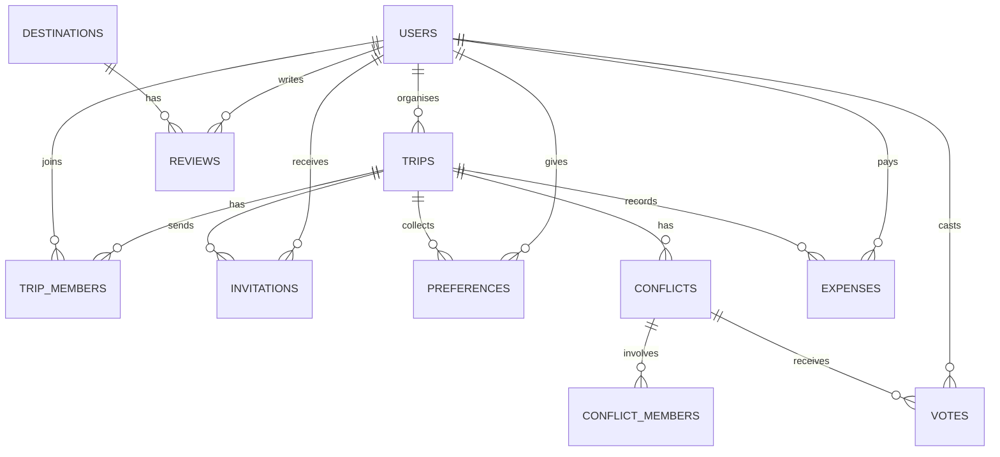

# TripSync AI

### An AI-powered collaborative travel planner

TripSync AI is a web application that helps a group of people plan a trip together. Each person
says what they want from the trip, and an AI combines everyone's wishes into **one day-by-day
itinerary** that suits the whole group. Where people's wishes clash, the app explains the clash,
suggests compromises and lets the group vote. It also keeps track of the trip budget and suggests
ways to save money.

The same app works for solo travellers, who get a personalised itinerary from their own preferences.

---

## 1. Problem Statement

Planning a trip with friends or family is usually harder than it should be.

- **Everyone wants something different.** One person wants adventure, another wants to relax,
  someone else is on a tight budget, and one person refuses to do anything too early in the morning.
- **Planning happens in a messy group chat.** Ideas get lost, quieter people are not heard, and
  the final plan is scattered across hundreds of messages.
- **Disagreements are settled unfairly.** Usually the most persistent person decides, and others
  end up on a trip they did not really want.
- **Nobody watches the budget.** It is hard to know what the plan will cost, who has paid for what,
  and whether the group is overspending.

Existing travel apps plan trips for **one person**. They do not help a **group** reach a plan
that is fair to everyone.

## 2. Proposed Solution

TripSync AI gives every traveller an equal voice and uses AI to do the hard work of combining
everyone's wishes:

1. The **organiser** creates a trip and invites friends.
2. **Each member** fills in their own preferences: interests, preferred pace, budget
   contribution, things they must do and things they want to avoid.
3. The **AI** reads everyone's preferences together and builds one itinerary. It prefers
   activities that several people will enjoy, and shows which members each activity suits
   (for example, *"Matches: Anjali, Anu"*).
4. When two people want opposite things, the AI does **not** silently pick a side. It explains
   the clash and suggests compromises, and the **people involved vote**. A majority decides; on a
   tie, the organiser decides.
5. The organiser can adjust the plan and then **finalise** it.
6. During the trip, the group **tracks spending** against the budget, and the AI suggests
   cheaper alternatives if the plan or spending gets close to the limit.

## 3. Target Users

| User | Description |
|---|---|
| **Groups of friends** | Students and young professionals planning trips together who find it hard to agree on a plan. |
| **Families** | Families with members of different ages and interests who need a plan that works for everyone. |
| **Solo travellers** | People travelling alone who want a quick, personalised itinerary and budget tracking. |
| **Administrator** | The person who manages the platform: users, destinations, reviews and overall usage. |

Inside the app, people take on these roles:

- **Traveller:** anyone with an account. They can create trips, join trips, add preferences and track budgets.
- **Trip organiser:** the person who created a trip. They invite members, generate and edit the
  itinerary, settle tied votes and finalise the plan.
- **Group member:** a traveller who accepted an invitation. They add their preferences, vote on
  clashes and view the shared plan and budget.
- **Administrator:** a separate account that manages the platform but does not take part in trips.

## 4. Features

### 4.1 User accounts and security
- Register and log in with email and password.
- Passwords are stored securely (hashed), and must be at least 8 characters with a letter and a number.
- Login sessions use secure tokens; logging out ends the session.
- Repeated failed logins are limited to stop password guessing.
- Separate **traveller** and **administrator** accounts, each seeing only their own pages.

### 4.2 Trip creation and management
- Create a **solo** or **group** trip with a name, destination, start point, dates, budget and a
  short description of what the trip should be like.
- Invite friends by email; they can accept or decline.
- The organiser can remove members, edit the trip, delete it, and later mark it as completed.
- A dashboard lists all trips with their status (planning, finalised, completed).

### 4.3 Preference collection
- Each member fills in interests (food, culture, adventure, nightlife and more), pace
  (relaxed, balanced or packed), budget contribution, must-do activities, things to avoid and
  any extra notes in their own words.
- The organiser can see who has filled in their preferences and who is still pending.

### 4.4 AI itinerary generation and group consensus *(core feature)*
- One AI engine creates the itinerary for both solo and group trips.
- The plan is shown **day by day in tabs**, with each activity's time, description and
  estimated cost, and which members it suits.
- The organiser can edit, move or remove activities, ask the AI to **redo one day** with an
  instruction (e.g. *"make day 3 less tiring"*), or generate a completely new plan.
- **Clashes** between members are shown with the AI's reasoning and compromise options.
- Members involved **vote**; the majority choice is added to the plan automatically.
- If the AI gives an incomplete or invalid answer, the app checks it, retries automatically, and
  never damages the existing plan.

### 4.5 Budget tracking and optimisation
- Shows the **total budget**, **planned expenses** (from the itinerary plus planned extras) and
  **actual spending**, kept separate so nothing is counted twice.
- Shows how much is left, and warns when spending reaches 80% or goes over budget.
- Add, edit and delete expenses by category (accommodation, food, transport, activities,
  miscellaneous) and by who paid.
- Shows each member's contribution and how much they have paid.
- **AI cost-saving suggestions**, such as a cheaper replacement for a specific activity, which the
  organiser can apply with one click.

### 4.6 Destinations and reviews
- Browse destinations with pictures, region, cost tier (budget, mid-range or luxury) and ratings.
- After completing a trip, travellers can rate and review the destination.

### 4.7 Administration
- Platform statistics: total users, total trips, solo vs group trips, average group size and
  popular destinations.
- View all users and deactivate or reactivate accounts.
- Monitor all trips (destination, dates, organiser, members and status).
- Add, edit and remove destinations, and hide inappropriate reviews.

### 4.8 Itinerary download
- Download the itinerary as a **PDF**. Each download is saved in MongoDB along with who
  downloaded it and a copy of the itinerary.

## 5. Database Design

The project uses two databases, each for what it does best:

- **MySQL** stores all the main application data. This data is closely linked (users belong to
  trips, trips have preferences, votes and expenses), so a relational database keeps it consistent.
- **MongoDB** stores the downloaded itinerary PDFs, which are stored as whole documents.

### 5.1 MySQL tables

| Table | What it stores |
|---|---|
| **users** | Name, email, hashed password, role (traveller or admin), default interests and pace, whether the account is active. |
| **trips** | Trip name, organiser, solo/group type, destination, start point, dates, budget, number of travellers, description, status, and the AI-generated itinerary. |
| **trip_members** | Which users are members of which trip (the organiser is a member too). |
| **invitations** | Invitations to group trips and whether they are pending, accepted or declined. |
| **preferences** | Each member's preferences for a trip: interests, pace, budget contribution, must-dos, things to avoid and notes. |
| **conflicts** | Clashes found by the AI: description, reasoning, the compromise options, and the final decision. |
| **conflict_members** | Which members are involved in each clash (only they can vote on it). |
| **votes** | Each member's vote on a clash. |
| **expenses** | Planned and actual expenses: category, amount, who paid, a note, and who added it. |
| **destinations** | Destination name, region, description, average cost, cost tier, pictures and average rating. |
| **reviews** | Travellers' star ratings and comments for destinations, and whether the admin has hidden them. |

### 5.2 How the tables are related

In words:
- A **user** can organise many trips and be a member of many trips.
- A **trip** has many members, invitations, preferences (one per member), clashes and expenses.
- A **clash** involves some of the trip's members, and each of them can cast one vote.
- A **destination** has many reviews, and each user can review a destination once.

### 5.3 MongoDB collection

| Collection | What it stores |
|---|---|
| **downloads** | One document per user per trip: the user's details, the trip details, a copy of the itinerary, the PDF file and how many times it was downloaded. |

## 6. Major React Pages

| Page | Purpose |
|---|---|
| **Login / Register** | Create an account or sign in. A travel-themed split layout with password hints. |
| **My Trips (dashboard)** | Lists all of the user's trips with status, plus pending invitations. |
| **Plan a Trip** | Form to create a new solo or group trip. |
| **Trip Overview** | Trip details, travellers, next steps, and organiser actions (edit, delete, complete). |
| **Edit Trip** | Change the trip's name and details. |
| **Members** | Invite friends by email and see who has filled in their preferences. |
| **Preferences** | Each member enters their interests, pace, budget contribution, must-dos and things to avoid. |
| **Itinerary** | The AI plan in day tabs with expandable activity cards; organiser tools to edit, redo a day, finalise; PDF download. |
| **Votes** | Clashes with the AI's reasoning and options; members vote, the organiser settles ties. |
| **Budget** | Budget summary, category breakdown, member contributions, expenses and AI saving tips. |
| **Invitations** | Accept or decline invitations to group trips. |
| **Destinations / Destination Detail** | Browse places by name and cost tier; see pictures, ratings and reviews. |
| **Profile** | Update name and default interests and pace. |
| **Admin Panel** | Statistics, users, trip monitoring, destinations and review moderation (admin only). |

## 7. Backend API Requirements

The React frontend talks to an Express/Node backend through a REST API that sends and receives
JSON. Every request except register and login must include the user's login token. The backend
checks that the user is allowed to do what they are asking (for example, only trip members can
see a trip, and only the organiser can change it).

| Area | What the API must provide |
|---|---|
| **Authentication** | Register, log in, log out, view and update the user's profile. |
| **Trips** | Create, list, view, edit and delete trips; invite members; accept or decline invitations; remove members; mark a trip completed. |
| **Preferences** | View all members' preferences for a trip and save the user's own. |
| **Itinerary** | Generate the AI itinerary, redo a single day, edit/move/remove activities and finalise the plan. |
| **Votes** | List clashes, cast a vote, and let the organiser decide a clash. |
| **Budget** | Get the budget summary; add, edit and delete expenses; get AI saving tips and apply one. |
| **Download** | Produce the itinerary PDF and save it to MongoDB. |
| **Destinations** | List and search destinations, view one destination, add and delete reviews. |
| **Admin** | Statistics, user list and activation, trip monitoring, destination management, review moderation. |

The AI is called only from the backend, through a separate Python service that talks to
Google Gemini, so the AI key is never exposed to the browser.

## 8. Technology Stack

| Part | Technology |
|---|---|
| Frontend | React with Vite, React Router, Axios |
| Backend | Node.js with Express |
| Databases | MySQL (main data) and MongoDB Atlas (downloaded PDFs) |
| AI | Python (FastAPI) service using Google Gemini |
| Security | JWT login tokens, bcrypt password hashing |

## 9. Future Scope

- An AI travel assistant chat for each trip (packing tips, local advice, questions about the plan).
- Real flight and hotel search and booking, with payments.
- Live collaborative editing so everyone sees changes instantly.
- Support for multiple currencies.
- A mobile app using the same backend.
